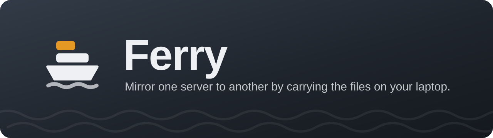
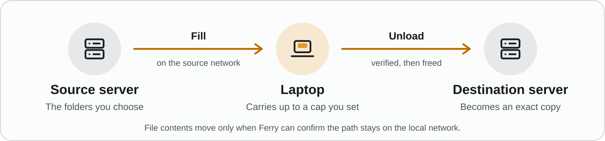
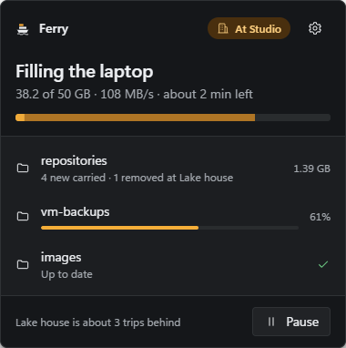
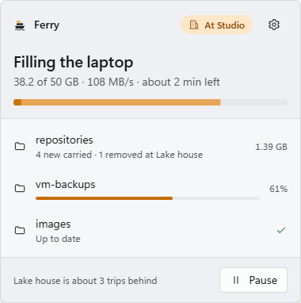

  

  
  
  
  

  <a href="#get-started">Get started</a> ·
  <a href="docs/how-it-works.md">How it works</a> ·
  <a href="docs/safety.md">Safety</a> ·
  <a href="docs/updates.md">Updates</a>

Ferry is a Windows tray app that keeps a **destination** SMB server an exact copy of folders on a **source** SMB server, by carrying the files on your laptop. Bulk data never goes over the internet: Ferry only copies when the laptop is on the server's own local network.

It is a one-way mirror. The destination ends up matching the source, deletions included.

## Is Ferry for you?

**Yes, if** you have two servers at two places you visit with the same Windows laptop (a studio and a home archive, a main office and a branch, an on-site NAS and an off-site backup), and more data than you want to push through the internet link between them.

**No, if** the link to the destination is fast enough to sync directly. A normal sync tool is simpler.

In setup you give each place a name of your own, like "Studio" and "Lake house", and Ferry uses those names in its messages.

## How a trip works

  

1. **Fill, at the source.** Ferry notices the network, compares the source with what the destination already has, and copies what is missing or changed onto the laptop, up to a size cap you set.
2. **Unload, at the destination.** Ferry pushes the carried files, reads each one back to check it, and frees the laptop space.
3. **Deletes follow.** Once everything new has landed, files deleted at the source are deleted at the destination too.

You do nothing during this. The tray icon and its flyout show where you are, what is on the laptop and how far behind the destination is.

  
  &nbsp;
  

The flyout follows Windows light and dark mode and your accent color. Sample data: the source is named Studio and the destination Lake house.

## Get started

### You need

- Windows 10 or 11, 64-bit.
- Two SMB servers you can sign in to (Unraid, TrueNAS, Synology, Windows shares and so on).
- A laptop that is on the source network and the destination network at different times, with disk space for the files it carries.
- Optional: a VPN or other remote route to either server. Ferry works without one.

### Install

Download from the [latest release](https://github.com/zaryabmustafa/ferry/releases/latest):

| File | What it is |
|---|---|
| `Ferry-Setup-<version>.exe` | The installer. Installs for you only, no admin rights needed, and [keeps Ferry up to date](docs/updates.md). Uninstalling keeps your settings and anything still on the laptop. |
| `Ferry-<version>-portable-x64.zip` | The same `ferry.exe`, to unzip and run anywhere. Doesn't update itself. |
| `SHA256SUMS.txt`, `.sig` | Checksums for both, and their signature. |

**Ferry isn't code-signed yet**, so Windows warns the first time you run it:

- **SmartScreen** says "Windows protected your PC". Choose **More info**, then **Run anyway**. Check the file first if you like: its SHA-256 is in `SHA256SUMS.txt`.
- **Smart App Control** (Windows 11) blocks unsigned apps with no way past it. If it is on, Ferry won't start until it is turned off, and Windows only turns it back on with a reinstall.

Updates aren't affected: Ferry checks each one against its own update signature before installing it ([How updates work](docs/updates.md)).

### First run

1. **Start Ferry.** A tray icon appears. Ferry starts with Windows from now on (turn that off in Settings).
2. **Open Ferry from the tray** and follow setup: name each server, enter its LAN address, user name and password (and a remote address if you have one), then choose your first folder pair.
3. **Teach Ferry each place.** While you are on the source network, choose "Remember as {name} network". Do the same at the destination when you are there. Later, use Remember this network under Locations.

Passwords are kept in Windows Credential Manager, not in the config file.

**Reinstalling Windows?** Export a backup first (Settings > Backup), then choose Restore from a backup on the first setup screen. [What a backup holds →](docs/how-it-works.md#backup-and-restore)

## Good to know

**Ferry is careful with your files.**

- An existing file at the destination is only replaced once a new copy has been read back and verified.
- Deletes wait until everything new has landed. A pass that would delete more than 10% of a folder, or more than 50 files, waits for your OK.
- A failed, partial or empty source listing deletes nothing.
- Interrupted copies pick up where they stopped.
- Files that are still being written are skipped until they settle.

[All the safety rules →](docs/safety.md)

**Ferry only copies on the local network.** It recognises each place by its router and checks that the path to the server stays local. With Tailscale it checks the path itself; with other VPNs that capture local traffic it won't copy unless you turn on "Trust this VPN for copies". On networks you don't control, pause Ferry.
[When Ferry copies, and VPNs →](docs/how-it-works.md)

**Ferry updates itself quietly.** About once a day, never on a metered connection or during a trip, and only with releases signed with Ferry's update key. Turn it off in Settings > Updates.
[How updates work →](docs/updates.md)

**Nothing else leaves your laptop.** Ferry talks only to your two servers, plus the daily update check.

## Limitations

- Windows only (10 and 11, 64-bit).
- One source, one destination, one laptop.
- One-way. Changes made only at the destination are overwritten or deleted.
- No version history or recycle bin of its own.
- No rename detection: a renamed folder is carried again in full.
- Files on the laptop aren't encrypted. Turn on BitLocker if the data is sensitive.
- Ferry doesn't wake a sleeping laptop; it only keeps it awake during a transfer.
- VPN path checks exist for Tailscale only.

## More

- [How it works](docs/how-it-works.md): when Ferry copies, VPNs, working without a remote route, where files live, footprint.
- [Safety](docs/safety.md): every rule that protects your data.
- [Updates](docs/updates.md): automatic updates and how they are signed.
- [Building and contributing](docs/development.md): build from source, crates, tests.
- [Verification](docs/verification.md): measurements, checks and drills.
- [Roadmap](docs/roadmap.md): what's planned next, including macOS and Linux.
- [Security](SECURITY.md): how to report a vulnerability privately.

## License

Ferry is licensed under either the [Apache License 2.0](LICENSE-APACHE) or the [MIT license](LICENSE-MIT), at your option. Unless you say otherwise, any contribution you submit is dual licensed the same way, with no additional terms or conditions.

Ferry's windows are built with [Slint](https://slint.dev), included under the [Slint Royalty-free License 2.0](https://github.com/slint-ui/slint/blob/master/LICENSES/LicenseRef-Slint-Royalty-free-2.0.md), which asks for the "Made with Slint" badge shown under Install. A fork that publishes its own builds needs to show it too, or use Slint under the GPL-3.0 or a commercial license. Every other dependency is under MIT, Apache-2.0, BSD, Zlib, Unicode-3.0 or BSL-1.0.
